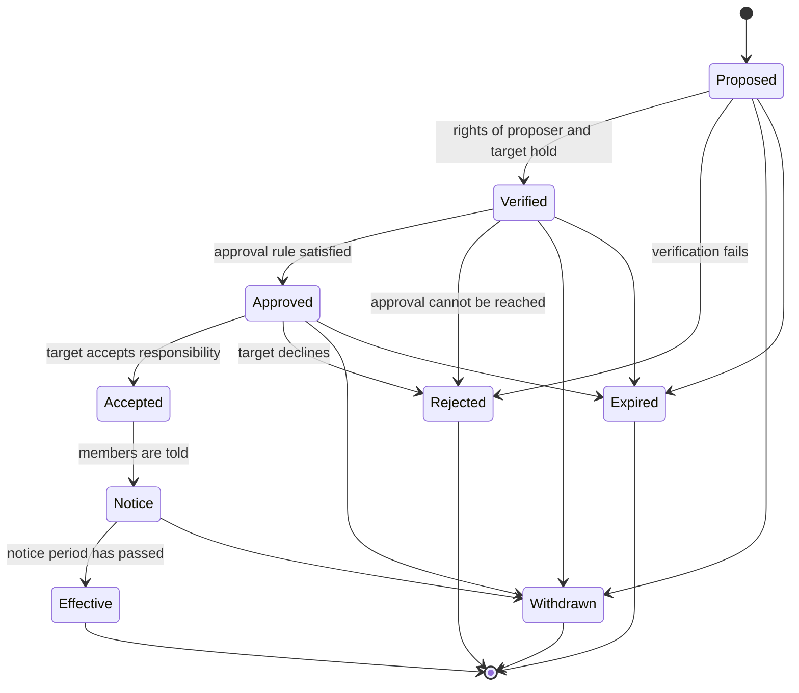

<!--
SPDX-FileCopyrightText: 2026 Open Communities Core contributors
SPDX-License-Identifier: CC-BY-4.0
-->

# Governance policy

- Status: Draft
- Version: 0.1
- Date: 2026-11-22
- Editor: Adrian Boros
- Schema: [`schemas/governance-policy.schema.json`](schemas/governance-policy.schema.json)
- Examples: [`examples/`](examples/)

Nothing in this document is implemented yet. It is published as a draft so that it can be
reviewed before the first implementation, and it will change.

## 1. Purpose

A community on Open Communities Core has no owner field. Who controls a community is the set of
rights its **governance policy** grants at a given moment. This document defines:

- the policy document: roles, rights, approval rules, an optional recovery rule;
- four governance modes and the constraints each puts on a policy;
- the transfer of control from one party to another, with the guarantees members keep;
- the governance log that records every decision.

A second implementation that follows this document can read a policy written by the first,
decide the same questions the same way, and continue the same log.

The key words MUST, MUST NOT, SHOULD, SHOULD NOT and MAY are to be read as in
[RFC 2119](https://www.rfc-editor.org/rfc/rfc2119) and
[RFC 8174](https://www.rfc-editor.org/rfc/rfc8174).

## 2. Terms

| Term | Meaning |
|---|---|
| **Community** | a group with its own identity, members and policy, hosted on a node |
| **Member** | a person or an organisation holding a membership in a community |
| **Right** | a named permission to perform one kind of action in a community (§4) |
| **Role** | a named set of rights that members can hold (§5) |
| **Controlling role** | the role the policy names as holding control of the community (§5.2) |
| **Controller** | the member or members holding the controlling role |
| **Policy** | the JSON document defined in §3; a community has exactly one in force |
| **Proposal** | a recorded request to perform a governed action that needs approval (§6) |
| **Transfer of control** | a change of controller, carried out as defined in §8 |
| **Governance log** | the append-only record of proposals, decisions and transfers (§10) |
| **Node** | an installation that hosts communities; its operator is not a party to a policy |

## 3. The policy document

A policy is a JSON object that validates against the schema and satisfies the rules of this
document that a schema cannot express (listed in §12).

| Member | Required | Content |
|---|---|---|
| `spec` | yes | the string `occ.governance-policy` |
| `version` | yes | the version of this document the policy follows: `0.1` |
| `mode` | yes | `individual`, `institutional`, `shared` or `transitional` (§7) |
| `roles` | yes | the roles of the community (§5) |
| `control` | yes | which role is the controlling role, and what kind of member holds it (§5.2) |
| `rules` | yes | approval rules for governed actions (§6); may be empty |
| `transfer` | no | parameters of a transfer of control (§8.3) |
| `recovery` | no | the recovery rule (§9) |
| `transition` | only in `transitional` mode | the transfer in progress (§7.4) |
| `extensions` | no | data defined by extensions, keyed by extension name (§4.2) |

### 3.1 Identity of a policy

The **digest** of a policy is the SHA-256 hash, in lowercase hexadecimal, of its canonical form
under the JSON Canonicalization Scheme ([RFC 8785](https://www.rfc-editor.org/rfc/rfc8785)).
The governance log refers to policies by digest. Two policies with the same digest are the same
policy.

### 3.2 One policy in force

A community has exactly one policy in force at any time. A policy is replaced only by a
`policy.amend` action or by a transfer of control taking effect. Both are recorded in the
governance log with the digests of the old and the new policy.

## 4. Rights

A right is a string of two or more lowercase segments separated by dots, for example
`membership.invite`. The first segment is the **namespace**.

### 4.1 Core rights

| Right | Permits |
|---|---|
| `community.update` | changing the community's name, description and settings |
| `community.close` | closing the community |
| `membership.invite` | issuing and revoking invitations |
| `membership.admit` | accepting or refusing a request to join |
| `membership.remove` | ending another member's membership |
| `role.grant` | granting a role to a member |
| `role.revoke` | withdrawing a role from a member |
| `policy.amend` | replacing the policy in force with another policy in the same mode |
| `privacy.change` | changing the community's privacy mode |
| `portability.export` | exporting the community archive |
| `portability.move` | authorising the community to move to another node |
| `transfer.propose` | proposing a transfer of control |
| `log.read` | reading the governance log |

The namespaces `community`, `membership`, `role`, `policy`, `privacy`, `portability`,
`transfer`, `recovery` and `log` are reserved for this specification.

Rights that every member has, and that a policy cannot take away, are not listed in a policy:
leaving the community, exporting one's own data, and being told of a transfer of control (§8.4).

### 4.2 Extension rights

An extension (an optional capability that a community may or may not have) defines its own
rights in a namespace of its own, for example `calendar.publish`. An extension MUST NOT define a
right in a reserved namespace.

An implementation that reads a policy naming a right it does not know:

- MUST keep the right in the policy unchanged, also when exporting it;
- MUST NOT treat the right as permitting anything;
- SHOULD report the unknown right to the controller.

This lets a community move to a node that lacks an extension without its policy being rewritten.

## 5. Roles

A role has:

| Member | Required | Content |
|---|---|---|
| `id` | yes | a name unique within the policy, lowercase letters, digits and underscores |
| `rights` | yes | the rights the role holds |
| `delegable` | no | the subset of `rights` that a holder may delegate (§5.3) |
| `min_holders` | no | the least number of holders the role may have; default 0 |
| `max_holders` | no | the greatest number of holders; no limit when absent |

Which member holds which role is not part of the policy. It is recorded by `role.granted` and
`role.revoked` entries in the governance log.

An action that would leave a role with fewer than `min_holders` or more than `max_holders`
holders MUST be refused.

### 5.1 Checking a right

A member may perform an action when a role they hold, or a delegation they hold, includes the
right, and the approval rule for that action, if there is one, is satisfied (§6). There is no
other source of authority inside a community. In particular the node operator holds no right in
a community by operating the node.

### 5.2 The controlling role

`control` names one role of the policy as the controlling role and says what kind of member
holds it:

| Member | Content |
|---|---|
| `role` | the `id` of a role in `roles` |
| `holder` | `person` or `organisation` |

The controlling role MUST hold `policy.amend`, `role.grant`, `role.revoke` and
`transfer.propose`, and MUST have `min_holders` of at least 1.

When `holder` is `organisation`, the role is held by one organisation, and the organisation
designates the persons who act for it. Their actions are recorded with both identities.

### 5.3 Delegation

A holder of a role MAY delegate a right listed in that role's `delegable` to another member.

- A delegation names one right, the member who gives it and the member who receives it.
- It MAY carry an end time. It ends when that time passes, when the giver withdraws it, or when
  the giver stops holding the role.
- A delegated right cannot be delegated again.
- `policy.amend` and `transfer.propose` MUST NOT be listed in `delegable`.

Delegations are recorded in the governance log.

## 6. Approval rules

A **rule** attaches an approval requirement to a right:

| Member | Required | Content |
|---|---|---|
| `action` | yes | the right the rule governs |
| `approval` | yes | the requirement (below) |
| `expires_after_days` | no | how long a proposal stays open; default 30 |

| `approval.type` | Satisfied when |
|---|---|
| `none` | the member holds the right; no proposal is needed |
| `count` | at least `count` holders of `role` have approved |
| `all` | every holder of `role` has approved |

A right with no rule behaves as if its rule were `none`. A policy MUST NOT contain two rules for
the same `action`.

When the approval type is `count` or `all`, the action starts as a proposal:

1. A member holding the right creates the proposal. If the proposer holds the approving role,
   the proposal counts as their approval.
2. Holders of the approving role approve or reject. An approval or a rejection cannot be changed
   once recorded.
3. The proposal is **approved** when the requirement is met. It is **rejected** when the
   requirement can no longer be met. It is **expired** when `expires_after_days` pass first. The
   proposer MAY **withdraw** it while it is open.
4. Only an approved proposal is carried out, and it is carried out once.

Approvals are counted against the holders of the role at the moment each approval is recorded. A
member who stops holding the role keeps the approvals they already gave.

Two open proposals for the same action that cannot both be carried out (for example two
transfers of control) are decided in the order they were created: when the first is carried out,
the second is rejected.

## 7. Modes

Every policy is in exactly one mode. The mode is a statement about who the controller is, and it
constrains the rest of the policy.

| Mode | Controller | Constraints |
|---|---|---|
| `individual` | one person | §7.1 |
| `institutional` | one organisation | §7.2 |
| `shared` | several members under approval rules | §7.3 |
| `transitional` | an outgoing and an incoming controller, for a limited time | §7.4 |

The mode `collective`, in which members decide by vote, is reserved. A policy with
`"mode": "collective"` is not valid under version 0.1 (§13).

A change of mode is never made by `policy.amend`. It is made by a transfer of control (§8).

### 7.1 Individual

- `control.holder` MUST be `person`.
- The controlling role MUST have `max_holders` equal to 1.

The controller administers alone and may delegate (§5.3).

### 7.2 Institutional

- `control.holder` MUST be `organisation`.
- The controlling role MUST have `max_holders` equal to 1.

### 7.3 Shared

- The controlling role MUST have `min_holders` of at least 2.
- There MUST be rules for `policy.amend` and `transfer.propose` whose approval type is `count`
  with a `count` of at least 2, or `all`, and whose approving role is the controlling role.

Holders of the controlling role in a shared policy may be persons, organisations or both;
`control.holder` states the kind that is required and all holders MUST be of that kind. A mixed
controlling role is not expressible in version 0.1 (§13).

### 7.4 Transitional

A community is in transitional mode from the acceptance of a transfer of control until the
transfer takes effect or is abandoned (§8). A transitional policy is built by the implementation,
not written by hand:

- its `roles`, `control`, `rules`, `transfer` and `recovery` are those of the policy that was in
  force when the transfer was accepted (the **outgoing policy**);
- it carries a `transition` object:

| Member | Content |
|---|---|
| `from` | the digest of the outgoing policy |
| `to` | the complete policy that takes effect at the end (the **incoming policy**); its mode MUST NOT be `transitional` |
| `suspended` | rights that nobody may use during the transition |
| `incoming` | rights the incoming controller may use during the transition |

`suspended` MUST include `policy.amend`, `community.close`, `privacy.change`,
`portability.move` and `transfer.propose`. `incoming` MUST NOT include any right other than
`log.read`.

So during the transition the community keeps working as before, nobody can change its rules or
move it, and the incoming controller can read the governance log and nothing else.

## 8. Transfer of control

A transfer of control replaces the policy in force with another policy and, with it, the
controller. It is the only way to change the controlling role's holder kind or the mode.

### 8.1 States

### 8.2 Steps

1. **Proposal.** A member holding `transfer.propose` proposes. The proposal names the target (a
   person or an organisation) and contains the complete incoming policy.
2. **Verification.** The implementation checks that the proposer holds the right, that the
   incoming policy is valid, and that the target can hold the controlling role of the incoming
   policy: a person MUST be a member of the community; an organisation MUST exist on the node.
3. **Approval.** The rule for `transfer.propose` in the policy in force is applied (§6).
4. **Acceptance.** The target accepts explicitly. Acceptance records that the target takes
   responsibility for the community and, where the target becomes responsible for the members'
   personal data, that it acknowledges this. No transfer takes effect without acceptance.
5. **Notice.** The community enters transitional mode (§7.4) and every member is told (§8.4).
6. **Effect.** When the notice period has passed, the incoming policy comes into force, the
   target holds its controlling role, and the roles of the outgoing policy end. Members keep
   their membership. A role of the incoming policy with the same `id` as a role of the outgoing
   policy keeps its holders, except the controlling role.

Until step 6, the proposer or the target MAY withdraw. A proposal that is not accepted within
`transfer.accept_within_days` of its approval expires.

### 8.3 Parameters

| Member of `transfer` | Default | Content |
|---|---|---|
| `notice_days` | 14 | length of the notice period; MUST be at least 14 |
| `accept_within_days` | 30 | how long the target has to accept after approval |

### 8.4 Guarantees to members

These hold for every transfer of control, in every mode, and a policy cannot weaken them.

**G1. Notice.** Before a transfer takes effect, every member MUST be told who the incoming
controller is, when the transfer takes effect, how the incoming policy differs from the outgoing
one, and that they may leave. The notice period MUST be at least 14 days and starts when the
notice has been issued to all members.

**G2. Leaving.** During the notice period a member MAY leave the community and export their own
data. A member who leaves before the transfer takes effect is not a member under the incoming
controller.

**G3. No wider audience.** A transfer never widens the audience of what already exists. Content
created before the transfer takes effect stays readable by the members who could read it then. A
member cannot read it by virtue of a role granted under the incoming policy alone. This applies
to the incoming controller as to anyone else.

**G4. A transfer that does not happen changes nothing.** When a proposal is rejected, withdrawn
or expired, at any step including the notice period, the policy that was in force before the
proposal is in force again with the same members, the same role holders and the same
delegations. The only trace is in the governance log.

G3 requires an implementation to record, for content with a limited audience, enough to decide
who could read it before a transfer. How content and audiences are represented is outside this
document.

## 9. Recovery

A community whose controller disappears cannot amend its policy or transfer control. A
**recovery rule** provides a way out without involving the node operator.

### 9.1 The rule

| Member of `recovery` | Required | Content |
|---|---|---|
| `inactivity_days` | yes | how long every holder of the controlling role must have been inactive; MUST be at least 30 |
| `successor` | one of the two | `membership`: the member who may claim control |
| `quorum` | one of the two | `count`: how many members together may propose a transfer of control; MUST be at least 2 |

A holder of the controlling role is **inactive** when they have performed no authenticated
action on the node for the stated period.

When every holder is inactive, recovery is **open**:

- the `successor`, if named, MAY claim control: this creates a transfer of control to the
  successor with the outgoing policy as the incoming policy, already approved;
- `quorum.count` members, if a quorum is defined, MAY together propose a transfer of control to
  a member, which is then treated as approved.

From there the transfer follows §8 from the acceptance step, including the notice period and the
guarantees of §8.4. If a holder of the controlling role performs an authenticated action before
the transfer takes effect, recovery closes and the transfer is withdrawn (G4).

### 9.2 When a recovery rule is required

A recovery rule is optional for a community of up to 50 members. A policy without one is valid,
and such a community has no recovery other than what its members arrange themselves.

Above 50 members a recovery rule is required:

- A community that has 50 members and a policy without a `recovery` rule MUST NOT admit a
  further member. Invitations may still be issued; accepting one is refused with a reason that
  names this rule.
- Nothing else is restricted. Existing members and everything they could do are unaffected.
- The controller SHOULD be warned before the limit is reached.
- A `policy.amend` that removes the recovery rule from a community of more than 50 members MUST
  be refused.

Members are counted as memberships in force. Pending invitations and ended memberships are not
counted. The number 50 is fixed by this specification and is not configurable, so that a policy
valid on one node is valid on every node.

## 10. The governance log

The governance log is an append-only sequence of entries per community. An entry is never
changed or removed. The log is part of the community archive and travels with the community when
it moves.

Every entry has:

| Field | Content |
|---|---|
| `seq` | position in the log, starting at 1, without gaps |
| `at` | time of the entry, UTC, [RFC 3339](https://www.rfc-editor.org/rfc/rfc3339) |
| `type` | the kind of entry (below) |
| `actor` | the member who acted, and the person acting for an organisation where there is one; absent for entries the implementation makes itself |
| `policy` | the digest of the policy in force when the entry was made |
| `data` | what the entry is about, by type |

| Types | Recorded when |
|---|---|
| `policy.adopted`, `policy.amended` | a policy comes into force; `data` carries the full policy |
| `role.granted`, `role.revoked` | a member starts or stops holding a role |
| `delegation.granted`, `delegation.ended` | a delegation starts or ends, with the reason |
| `proposal.created`, `proposal.approved_by`, `proposal.rejected_by`, `proposal.approved`, `proposal.rejected`, `proposal.withdrawn`, `proposal.expired`, `proposal.carried_out` | each step of a proposal (§6) |
| `transfer.verified`, `transfer.accepted`, `transfer.notice_issued`, `transfer.effective`, `transfer.abandoned` | each step of a transfer of control beyond its proposal (§8) |
| `recovery.opened`, `recovery.claimed`, `recovery.closed` | each step of a recovery (§9) |

An extension records its own entries with a type in its own namespace. The rules of §4.2 for
unknown rights apply to unknown entry types: keep them, export them, give them no meaning.

The first entry of every log is `policy.adopted`. The policy in force and the holders of every
role at any time can be derived from the log alone.

How the integrity of the log is protected, and how personal data in it is handled when a member
leaves, is defined by the community archive specification.

## 11. Relation to other work

- **ActivityPub and ActivityStreams.** A policy and a governance log are not ActivityStreams
  objects and are never delivered to another server through federation. Where a community has a
  federated actor, the policy decides who may act through it; the actor document does not expose
  the policy, the roles or their holders.
- **Data portability (W3C Social Web Community Group).** That work concerns moving an account
  and its content between servers. This document concerns who may decide for a community. The
  right `portability.move` is the point where they meet: it says who may authorise a move, not
  how the move is done.
- **Other specifications in this folder.** The community archive carries the policy and the
  log. The privacy modes say what `privacy.change` can select. Neither is defined here.

## 12. Rules a schema cannot express

A validator MUST check these in addition to the schema:

1. Role `id` values are unique; `control.role` names one of them.
2. Every right in a role's `delegable` is in that role's `rights`.
3. `max_holders`, when present, is not smaller than `min_holders`.
4. No two rules have the same `action`; every `approval.role` names a role of the policy.
5. An approval of type `count` does not ask for more approvals than the approving role's
   `max_holders`.
6. The controlling role holds the four rights required by §5.2.
7. The mode constraints of §7.1 to §7.3 that refer to the controlling role.
8. In a transitional policy, `transition.to` is a valid policy that is not transitional, and
   `transition.from` is the digest of the outgoing policy as the governance log records it.

## 13. Not in version 0.1

- **Collective governance**: votes, elections, member quorums for ordinary decisions.
- **Mixed controllers**: a shared controlling role held by persons and organisations together.
- **Vetoes** and weighted approvals.
- **Verification of an organisation** beyond its existence on the node.
- **Moderation** of content and conduct.
- **What a node operator may do**: a matter for the operator's terms and for the privacy modes,
  not for a community's policy.

## 14. Open questions

1. Is 30 days the right floor for `inactivity_days`, and is "no authenticated action on the
   node" the right test of inactivity?
2. Should the notice of §8.4 be confirmed as received, or is issuing it enough?
3. Should a role with the same `id` keep its holders across a transfer (§8.2, step 6), or should
   the incoming policy state it?
4. Does G3 need a way for a member to widen the audience of their own earlier content on
   purpose?
